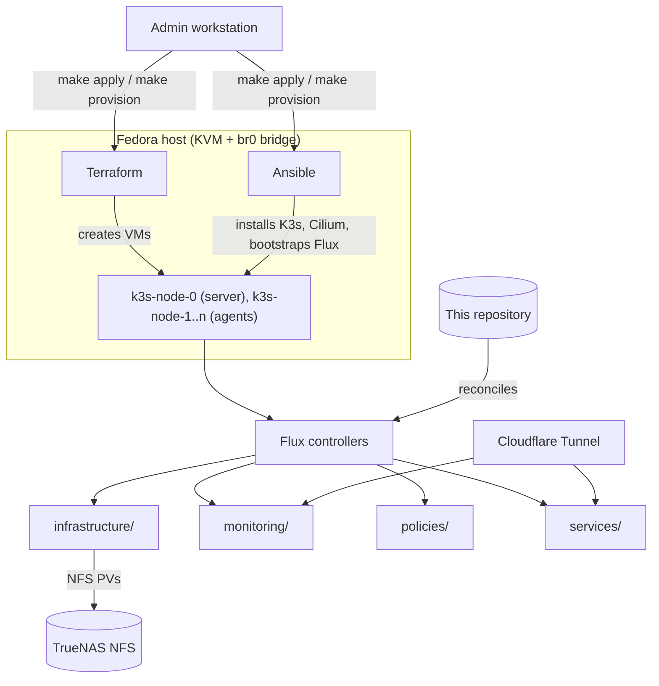

# Homelab: GitOps Kubernetes cluster

[](https://github.com/utkdwivedi/homelab/actions/workflows/ci.yaml)
[](LICENSE)
[](https://github.com/utkdwivedi/homelab/commits/main)

A declarative **K3s** homelab: Terraform creates the VMs, Ansible installs Kubernetes and Cilium, and **Flux** reconciles everything else from this repository. Secrets are encrypted with SOPS (age) and Ansible Vault.

Maintained by [Utkarsh Dwivedi](https://github.com/utkdwivedi).

## What is in here

| Layer | Tooling | Where |
| --- | --- | --- |
| Host and VMs | Fedora, KVM/libvirt, Terraform (`dmacvicar/libvirt`), cloud-init | `provisioning/terraform/`, `provisioning/ansible/roles/{virtualization,bridge}` |
| Kubernetes | K3s (no flannel, no kube-proxy, no Traefik, no ServiceLB), Cilium CNI with L2 announcements | `provisioning/ansible/roles/k3s_*` |
| GitOps | Flux (source, kustomize, helm, notification controllers) | `clusters/` |
| Platform | Namespaces, NFS storage classes, Cilium IP pool, Cloudflare Tunnel, Kyverno | `infrastructure/` |
| Observability | Prometheus (with alert rules), Alertmanager, Grafana, kube-state-metrics, node-exporter | `monitoring/` |
| Policy | Kyverno `ValidatingPolicy` resources (audit mode) | `policies/` |
| Apps | Jellyfin, Karakeep, SilverBullet | `services/` |
| Secrets | SOPS + age for manifests, Ansible Vault for bootstrap secrets | `.sops.yaml`, `provisioning/ansible/inventory/group_vars/` |

## Architecture



`clusters/<env>` holds the Flux entry points. `infrastructure` is reconciled first; `monitoring`, `policies` and `services` depend on it.

## Repository layout

```
.
├── clusters/{production,staging}/   Flux entry points (flux-system + one Kustomization per area)
├── infrastructure/{base,production,staging}/   namespaces, storage, networking, kyverno
├── monitoring/{base,production,staging}/       prometheus, alertmanager, grafana, exporters
├── policies/{base,production,staging}/         Kyverno policies
├── services/{base,production,staging}/         jellyfin, karakeep, silverbullet
├── provisioning/
│   ├── terraform/{modules/k3s-vms,production,staging}/
│   └── ansible/{playbooks,roles,inventory}/
├── config/{production,staging}.env  per-environment values (host IPs) read by make and scripts
├── scripts/                         env.sh, validate.sh, check-sops.sh, check_kustomize_refs.py
├── docs/                            bootstrap, secrets, disaster recovery, adding a service
├── resources/                       Grafana dashboard JSON
└── Makefile                         `make` lists every target
```

Each `base/` holds the manifests; `production/` and `staging/` are thin overlays that select what each environment runs.

## Quick start

Full walk-through: [docs/bootstrap.md](docs/bootstrap.md). In short:

```bash
# Tools: terraform, ansible, kubectl, sops, age, make (see .tool-versions)
make deps                                  # install Ansible collections
cp provisioning/terraform/production/terraform.tfvars.example provisioning/terraform/production/terraform.tfvars
$EDITOR provisioning/terraform/production/terraform.tfvars config/production.env

source scripts/env.sh production           # SSH agent, ANSIBLE_*, KUBECONFIG
make provision-host                        # KVM, bridge br0, Tailscale on the Fedora host
make init apply                            # create the VMs
make wait-vms provision                    # K3s, Cilium, then Flux takes over
make flux-status
```

Adjust the addresses in `config/<env>.env`, the Ansible inventories under `provisioning/ansible/inventory/` and `infrastructure/base/storage/` for your network. Values in this README (`192.168.x.x`) are placeholders.

## Day-to-day

| Task | Command |
| --- | --- |
| List all targets | `make` |
| Validate before pushing | `make lint validate check-secrets` (CI runs the same) |
| Rebuild a whole environment | `make rebuild ENV=staging CONFIRM=staging` |
| Edit bootstrap secrets | `make edit-vault` |
| Add a new app | [docs/adding-a-service.md](docs/adding-a-service.md) |

Destructive targets refuse to run without `CONFIRM=<env>`.

## Secrets

Kubernetes secrets are committed only as `*.sops.yaml`, encrypted to the age key in `.sops.yaml`. Flux decrypts them with the `sops-age` secret created during bootstrap. Never commit kubeconfigs, `.vault_pass`, `*.tfvars` or age private keys (all gitignored). Details and rotation steps: [docs/secrets.md](docs/secrets.md).

## Hardware

| Device | Role |
| --- | --- |
| Lenovo ThinkPad T14 Gen 1 | Production host (KVM) |
| Lenovo ThinkCentre M700 | Staging host (KVM) |
| HP EliteDesk 800 G2 SFF, 2x1TB WD Red | NAS (TrueNAS, ZFS mirror) |
| Lenovo Legion 5 Slim | Admin workstation |

## Backups

3-2-1 for data: TrueNAS ZFS mirror (primary), an external SSD (second local copy) and Backblaze B2 through TrueNAS Cloud Sync (offsite). This covers data on the NAS. Cluster state is rebuilt from Git; see [docs/disaster-recovery.md](docs/disaster-recovery.md) for what is and is not backed up.

## Known limitations and roadmap

Being honest about gaps keeps them on the list:

- [ ] All VMs of an environment run on one physical host, so there is no hardware high availability and a single K3s server.
- [ ] Prometheus stores data on a node `hostPath`; move it to a PVC or add remote write.
- [ ] Alertmanager has rules wired in but no notification receiver yet (see the comment in `monitoring/base/alertmanager/configmap.yaml`).
- [ ] No log aggregation (Loki) or tracing.
- [ ] No default-deny `NetworkPolicy` resources yet, although Cilium supports them.
- [ ] Kyverno policies run in `Audit`; switch to `Enforce` once the audit reports are clean.
- [ ] Some images still track `latest`/`release` tags; Renovate (`renovate.json`) is configured to pin digests once the Renovate app is installed on the repository.
- [ ] Restore from backup has not been rehearsed end to end.

## Acknowledgements

Layout ideas were inspired by the wider homelab and Flux community, including [khuedoan/homelab](https://github.com/khuedoan/homelab).

## License

MIT, see [LICENSE](LICENSE).
